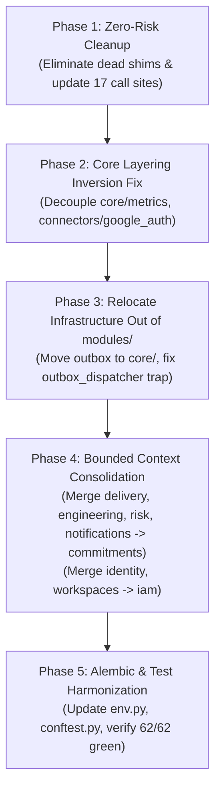

# Architecture Audit: Modular Monolith Baseline & Refactoring Blueprint

> **Audit Date:** October 10, 2026  
> **Target Directory:** `backend/src`  
> **Status:** Codebase Audit & Evidence-Based Verification  
> **Test Suite Baseline:** 62 passed, 0 failed, 4 warnings (Execution time: 11.50s)

---

## Executive Summary: Top 5 Findings

1. **Artificial Feature Fragmentation across Commitments:** The core business entity `Commitment` is fragmented across 5 separate modules (`commitments`, `delivery`, `engineering`, `risk`, `notifications`). 3 of these modules (`engineering`, `risk`, `notifications`) have **zero database tables**; they exist purely to query or augment `Commitment` data.
2. **Infrastructure Leaking into Domain Modules:** The Transactional Outbox pattern (`modules/outbox`) and Server-Sent Events gateway (`modules/realtime`) are placed inside `modules/`, masquerading as business capabilities rather than infrastructure/transport adapters.
3. **Core Layering Inversion & Circular Dependencies:** Lower-level packages depend on higher-level modules:
   - `core/security.py` directly imports `modules.identity.models.User` (lines 260, 329) and `modules.workspaces.models.Membership` (line 355).
   - `core/metrics.py:161` imports `modules.operations.router._query_celery_stats`.
   - `connectors/google_auth.py:15` imports `modules.operations.models.WorkspaceIntegration` and executes SQL queries.
   - `identity` and `workspaces` form a bidirectional circular dependency.
4. **Outbox Dispatcher Trap on Commitment Events:** `CommitmentService` persists outbox events with types `commitment.created`, `commitment.updated`, and `commitment.confirmed` (`modules/commitments/service.py:249, 340, 391`). However, `jobs/outbox_dispatcher.py:205` has no handler for these types and explicitly raises `ValueError: No Celery handler for event_type '{event_type}'`, creating a fatal failure mode if dispatched.
5. **Orphaned and Legacy Shim Files:** 5 compatibility shims exist in the codebase:
   - `ai/extractor.py` (imported by `jobs/tasks.py:7` and `tests/recovery/test_ai_resilience_and_fallback.py:6`).
   - `connectors/base.py` (imported by 15 files across connectors, services, and tests).
   - `ai/investigator.py`, `core/crypto.py`, and `jobs/dispatcher.py` have **zero importers** anywhere in the repository and are completely orphaned.

---

## 1. Module Inventory

Comprehensive audit of all 14 packages currently located under `backend/src/modules/`.

| Module | Files Present | SQLAlchemy Models (`class` & `__tablename__`) | Public Functions in `service.py` | Routes in `router.py` (Method & Path) | Celery Tasks & Outbox Events Produced / Consumed |
| :--- | :--- | :--- | :--- | :--- | :--- |
| **audit** | `__init__.py`<br>`models.py`<br>`router.py`<br>`service.py` | `AuditEvent`<br>(`audit_events`) | `record_audit_event` (line 10) | `GET /audit` (line 37) | **Produces:** None<br>**Consumes:** None (invoked synchronously by services) |
| **commitments** | `__init__.py`<br>`models.py`<br>`router.py`<br>`schemas.py`<br>`service.py` | `Commitment`<br>(`commitments`) | `to_dto` (line 59)<br>`CommitmentService.get_by_id` (line 101)<br>`CommitmentService.list_commitments` (line 115)<br>`CommitmentService.list_attention_commitments` (line 152)<br>`CommitmentService.list_all_workspace_commitments` (line 171)<br>`CommitmentService.create_commitment` (line 181)<br>`CommitmentService.update_commitment` (line 265)<br>`CommitmentService.confirm_commitment` (line 355)<br>`CommitmentService.delete_commitment` (line 406)<br>`CommitmentService.mark_delivered` (line 444)<br>`CommitmentService.generate_draft_update` (line 480)<br>`CommitmentService.create_candidate_commitments_batch_sync` (line 557) | `GET /commitments` (line 26)<br>`POST /commitments` (line 61)<br>`GET /commitments/{commitment_id}` (line 78)<br>`PATCH /commitments/{commitment_id}` (line 95)<br>`POST /commitments/{commitment_id}/confirm` (line 119)<br>`POST /commitments/{commitment_id}/draft-update` (line 136)<br>`DELETE /commitments/{commitment_id}` (line 154) | **Produces Outbox Events:**<br>`commitment.created` (line 249)<br>`commitment.updated` (line 340)<br>`commitment.confirmed` (line 391)<br>**Produces Celery:** None directly<br>**Consumes:** Reused by `jobs/tasks.py:62` |
| **customers** | `__init__.py`<br>`models.py`<br>`router.py`<br>`service.py` | `Customer`<br>(`customers`) | `CustomerService.list_customers_with_metrics` (line 18)<br>`CustomerService.create_customer` (line 92)<br>`CustomerService.get_customer_by_id` (line 119) | `GET /customers` (line 44)<br>`POST /customers` (line 75)<br>`GET /customers/{customer_id}` (line 104) | **Produces:** None<br>**Consumes:** None |
| **delivery** | `__init__.py`<br>`models.py`<br>`router.py`<br>`service.py` | `DeliveryEvidence`<br>(`delivery_evidences`) | `DeliveryService.list_evidence` (line 22)<br>`DeliveryService.verify_delivery` (line 84) | `GET /delivery/evidence` (line 45)<br>`POST /delivery/verify` (line 56) | **Produces Pub/Sub:**<br>`COMMITMENT_DELIVERED` (line 138)<br>**Consumes:** None |
| **engineering** | `__init__.py`<br>`router.py`<br>`service.py` | *None (0 models)* | `EngineeringService.list_linked_tickets` (line 20)<br>`EngineeringService.get_remote_ticket_status` (line 42) | `GET /engineering/tickets` (line 28)<br>`GET /engineering/tickets/{tracker}/{key}` (line 39) | **Produces:** None<br>**Consumes:** None |
| **identity** | `__init__.py`<br>`models.py`<br>`router.py`<br>`schemas.py`<br>`service.py` | `User` (`users`)<br>`Identity` (`identities`)<br>`Session` (`sessions`)<br>`RefreshToken` (`refresh_tokens`) | `IdentityService.get_user_workspaces` (line 33)<br>`IdentityService._ensure_default_workspace` (line 55)<br>`IdentityService._issue_token_pair` (line 87)<br>`IdentityService.register_user` (line 110)<br>`IdentityService.authenticate` (line 137)<br>`IdentityService.authenticate_google` (line 166)<br>`IdentityService.refresh_token_pair` (line 205)<br>`IdentityService.revoke_refresh_token` (line 309) | `POST /auth/register` (line 59)<br>`POST /auth/login` (line 82)<br>`POST /auth/refresh` (line 105)<br>`POST /auth/google` (line 137)<br>`POST /auth/logout` (line 212)<br>`GET /auth/me` (line 240) | **Produces:** None<br>**Consumes Celery:** Cleaned up by `jobs/tasks.py:413` (`cleanup_expired_tokens`) |
| **ingestion** | `__init__.py`<br>`models.py`<br>`router.py`<br>`service.py` | `IngestionJob`<br>(`ingestion_jobs`) | `IngestionService.queue_transcript_ingestion` (line 25)<br>`IngestionService.queue_audio_ingestion` (line 111) | `GET /ingestion/jobs` (line 49)<br>`POST /ingestion/upload` (line 76)<br>`POST /ingestion/upload-audio` (line 104) | **Produces Outbox Events:**<br>`ingestion.transcript.process` (line 63)<br>`ingestion.audio.process` (line 149)<br>**Consumes Celery:** Tasks in `jobs/tasks.py:102, 148` update `IngestionJob` |
| **mcp** | `__init__.py`<br>`gateway.py`<br>`server.py`<br>`tools.py` | *None (0 models)* | *No service.py* (Tools implemented in `tools.py`):<br>`list_commitments_tool` (line 24)<br>`get_commitment_evidence_tool` (line 68)<br>`create_commitment_tool` (line 111)<br>`create_update_draft_tool` (line 148) | `GET /mcp/tools` (line 79)<br>`POST /mcp/tools/call` (line 92) | **Produces:** None<br>**Consumes:** None |
| **notifications** | `__init__.py`<br>`router.py`<br>`service.py` | *None (0 models)* | `NotificationService.list_alerts` (line 20)<br>`NotificationService.send_alert` (line 40) | `GET /notifications` (line 38)<br>`POST /notifications/send` (line 49) | **Produces:** None<br>**Consumes Celery:** Dispatched via `jobs/tasks.py:485` (`dispatch_notification_alert`) |
| **operations** | `__init__.py`<br>`models.py`<br>`router.py`<br>`integrations_router.py`<br>`service.py` | `WorkspaceIntegration`<br>(`workspace_integrations`) | `IntegrationService.get_integration` (line 16)<br>`IntegrationService.get_decrypted_config` (line 30)<br>`IntegrationService.save_integration` (line 42)<br>`IntegrationService.disconnect_integration` (line 83) | **Operations Router:**<br>`GET /operations/status` (line 45)<br>`GET /operations/metrics` (line 60)<br>**Integrations Router:**<br>`GET /operations/integrations` (line 283)<br>`POST /operations/integrations/{provider}/connect` (line 310)<br>`POST /operations/integrations/{provider}/test` (line 402)<br>`POST /operations/integrations/{provider}/disconnect` (line 516)<br>`GET /operations/integrations/google/authorize` (line 594)<br>`GET /operations/integrations/google/callback` (line 615)<br>`POST /operations/integrations/google/connect-token` (line 751)<br>`POST /operations/integrations/google/calendar/sync-event` (line 801)<br>`POST /operations/integrations/google/gmail/send-update` (line 837) | **Produces:** None<br>**Consumes:** None |
| **outbox** | `__init__.py`<br>`models.py`<br>`service.py` | `OutboxEvent`<br>(`outbox_events`) | `create_outbox_event` (line 10) | *None (0 routes)* | **Produces:** Persists pending outbox rows in DB<br>**Consumes:** Polled by `jobs/outbox_dispatcher.py:81` |
| **realtime** | `router.py` | *None (0 models)* | *No service.py* | `GET /events/stream` (line 24)<br>`GET /realtime/stream` (line 25)<br>`POST /events/test-publish` (line 137)<br>`POST /realtime/test-publish` (line 138) | **Produces:** SSE stream events to HTTP clients<br>**Consumes Pub/Sub:** Subscribes to `ws:{workspace_id}:events` channel |
| **risk** | `__init__.py`<br>`router.py`<br>`service.py` | *None (0 models)* | `RiskService.list_risk_assessments` (line 18)<br>`RiskService.evaluate_workspace_risk` (line 45) | `GET /risk/assessments` (line 38)<br>`POST /risk/evaluate` (line 49) | **Produces Outbox Events:**<br>`risk.scan.request` (handled in dispatcher: line 187)<br>**Consumes Celery:** Scheduled via `scan_commitment_deadlines` (`jobs/tasks.py:246`) |
| **workspaces** | `__init__.py`<br>`models.py`<br>`router.py`<br>`schemas.py`<br>`service.py` | `Workspace` (`workspaces`)<br>`Membership` (`memberships`)<br>`Invitation` (`invitations`) | `WorkspaceService.create_workspace` (line 23)<br>`WorkspaceService.get_workspace` (line 48)<br>`WorkspaceService.get_user_membership` (line 53)<br>`WorkspaceService.list_members` (line 68)<br>`WorkspaceService.get_valid_invitation` (line 74)<br>`WorkspaceService.create_invitation` (line 97)<br>`invalidate_workspace_cache` (line 121)<br>`get_active_workspace_id` (line 129) | `POST /workspaces` (line 15)<br>`GET /workspaces/{workspace_id}` (line 27)<br>`GET /workspaces/{workspace_id}/members` (line 36) | **Produces:** None<br>**Consumes:** None |

---

## 2. Import Graph

### Module-Level Import Matrix (`importer -> imported`)

| Importer Module / Package | Target Module / Component | Import Count | Description & Context |
| :--- | :--- | :--- | :--- |
| `modules/commitments` | `modules.identity.models` | 2 | `service.py:28` (`User`), `router.py:20` (`User` for auth dependency) |
| `modules/commitments` | `modules.workspaces.service` | 1 | `router.py:21` (`get_active_workspace_id`) |
| `modules/commitments` | `modules.audit.service` | 1 | `service.py:15` (`record_audit_event`) |
| `modules/commitments` | `modules.outbox.service` | 1 | `service.py:29` (`create_outbox_event`) |
| `modules/customers` | `modules.identity.models` | 1 | `router.py:13` (`User` for auth dependency) |
| `modules/customers` | `modules.workspaces.service` | 1 | `router.py:14` (`get_active_workspace_id`) |
| `modules/customers` | `modules.commitments.service` | 1 | `service.py:10` (`CommitmentService`) |
| `modules/delivery` | `modules.identity.models` | 2 | `service.py:15` (`User`), `router.py:13` (`User`) |
| `modules/delivery` | `modules.workspaces.service` | 1 | `router.py:14` (`get_active_workspace_id`) |
| `modules/delivery` | `modules.commitments.service` | 1 | `service.py:13` (`CommitmentService`) |
| `modules/delivery` | `modules.audit.service` | 1 | `service.py:12` (`record_audit_event`) |
| `modules/engineering` | `modules.identity.models` | 1 | `router.py:10` (`User`) |
| `modules/engineering` | `modules.workspaces.service` | 1 | `router.py:11` (`get_active_workspace_id`) |
| `modules/engineering` | `modules.commitments.service` | 1 | `service.py:12` (`CommitmentService`) |
| `modules/engineering` | `modules.operations.service` | 1 | `service.py:13` (`IntegrationService`) |
| `modules/identity` | `modules.workspaces.models` | 1 | `service.py:23` (`Membership`, `Workspace`) |
| `modules/ingestion` | `modules.identity.models` | 1 | `router.py:17` (`User`) |
| `modules/ingestion` | `modules.workspaces.service` | 1 | `router.py:22` (`get_active_workspace_id`) |
| `modules/ingestion` | `modules.audit.service` | 2 | `service.py:14`, `router.py:18` (`record_audit_event`) |
| `modules/ingestion` | `modules.outbox.service` | 2 | `service.py:16`, `router.py:21` (`create_outbox_event`) |
| `modules/ingestion` | `jobs.tasks` | 2 | `router.py:24`, `service.py:19` (`process_transcript_ingestion`) |
| `modules/mcp` | `modules.identity.models` | 1 | `server.py:13` (`User`) |
| `modules/mcp` | `modules.workspaces.service` | 1 | `server.py:125` (`WorkspaceService`, `get_active_workspace_id`) |
| `modules/mcp` | `modules.commitments.service` | 1 | `tools.py:13` (`CommitmentService`) |
| `modules/notifications` | `modules.identity.models` | 1 | `router.py:10` (`User`) |
| `modules/notifications` | `modules.workspaces.service` | 1 | `router.py:12` (`get_active_workspace_id`) |
| `modules/notifications` | `modules.commitments.service` | 1 | `service.py:12` (`CommitmentService`) |
| `modules/notifications` | `modules.operations.service` | 1 | `service.py:13` (`IntegrationService`) |
| `modules/operations` | `modules.identity.models` | 1 | `integrations_router.py:20` (`User`) |
| `modules/operations` | `modules.workspaces.service` | 1 | `integrations_router.py:22` (`get_active_workspace_id`) |
| `modules/realtime` | `modules.identity.models` | 1 | `router.py:17` (`User`) |
| `modules/realtime` | `modules.workspaces.service` | 1 | `router.py:18` (`get_active_workspace_id`) |
| `modules/risk` | `modules.identity.models` | 1 | `router.py:10` (`User`) |
| `modules/risk` | `modules.workspaces.service` | 1 | `router.py:12` (`get_active_workspace_id`) |
| `modules/risk` | `modules.commitments.service` | 1 | `service.py:11` (`CommitmentService`) |
| `modules/risk` | `modules.audit.service` | 1 | `service.py:10` (`record_audit_event`) |
| `modules/workspaces` | `modules.identity.models` | 1 | `service.py:14` (`User`) |
| `jobs` | `modules.commitments.models` | 1 | `tasks.py:11` (`Commitment`) |
| `jobs` | `modules.commitments.service` | 1 | `tasks.py:62` (`CommitmentService`) |
| `jobs` | `modules.identity.models` | 2 | `tasks.py:430` (`RefreshToken`), `tasks.py:431` (`Session`) |
| `jobs` | `modules.ingestion.models` | 5 | `tasks.py:53, 128, 171, 200, 225` (`IngestionJob`) |
| `jobs` | `modules.outbox.models` | 3 | `tasks.py:262` (`OutboxEvent`), `outbox_dispatcher.py:34, 81` (`OutboxEvent`) |
| `connectors` | `modules.operations.models` | 1 | `google_auth.py:15` (**VIOLATION**) (`WorkspaceIntegration`) |
| `core` | `modules.identity.models` | 2 | `security.py:260, 329` (**VIOLATION**) (`User`) |
| `core` | `modules.workspaces.models` | 1 | `security.py:355` (**VIOLATION**) (`Membership`) |
| `core` | `modules.operations.router` | 1 | `metrics.py:161` (**VIOLATION**) (`_query_celery_stats`) |

### Categorized Flags

#### a) Module A importing Module B's `models.py` (Internals)
- `modules/identity/service.py:23` imports `modules.workspaces.models.Membership, Workspace` (1 instance)
- All other modules importing `modules.identity.models.User` do so strictly for the FastAPI dependency `get_current_user -> User` (15 instances across routers/services).

#### b) Module A importing Module B's `service.py`
- `modules/customers/service.py:10` -> `modules.commitments.service.CommitmentService`
- `modules/delivery/service.py:13` -> `modules.commitments.service.CommitmentService`
- `modules/engineering/service.py:12` -> `modules.commitments.service.CommitmentService`
- `modules/engineering/service.py:13` -> `modules.operations.service.IntegrationService`
- `modules/notifications/service.py:12` -> `modules.commitments.service.CommitmentService`
- `modules/notifications/service.py:13` -> `modules.operations.service.IntegrationService`
- `modules/risk/service.py:11` -> `modules.commitments.service.CommitmentService`
- `modules/mcp/tools.py:13` -> `modules.commitments.service.CommitmentService`
- `modules/mcp/server.py:125` -> `modules.workspaces.service.WorkspaceService`
- Cross-cutting service callers (`modules.audit.service.record_audit_event`: 4 modules; `modules.outbox.service.create_outbox_event`: 2 modules; `modules.workspaces.service.get_active_workspace_id`: 9 modules).

#### c) `core/` importing from `modules/`, `ai/`, `connectors/` or `jobs/` (Layering Violations)
- `core/security.py:260` -> `from modules.identity.models import User`
- `core/security.py:329` -> `from modules.identity.models import User`
- `core/security.py:355` -> `from modules.workspaces.models import Membership`
- `core/metrics.py:161` -> `from modules.operations.router import _query_celery_stats`

#### d) `ai/` or `connectors/` importing from `modules/` (Layering Violations)
- `ai/`: **0 violations** (Pure processing package).
- `connectors/`: **1 violation** -> `connectors/google_auth.py:15` imports `modules.operations.models.WorkspaceIntegration` and executes SQL queries on lines 124–127.

#### e) Circular Import Pairs
1. `modules/identity` $\longleftrightarrow$ `modules/workspaces`:
   - `identity/service.py:23` imports `workspaces.models.Membership, Workspace`
   - `workspaces/service.py:14` imports `identity.models.User`
2. `core` $\longleftrightarrow$ `modules/identity`:
   - `modules/identity` imports `core.security`
   - `core/security.py:260, 329` imports `identity.models.User`
3. `core` $\longleftrightarrow$ `modules/workspaces`:
   - `modules/workspaces` imports `core.security`
   - `core/security.py:355` imports `workspaces.models.Membership`
4. `core` $\longleftrightarrow$ `modules/operations`:
   - `modules/operations/router.py:57` imports `core.metrics`
   - `core/metrics.py:161` imports `modules.operations.router._query_celery_stats`
5. `connectors` $\longleftrightarrow$ `modules/operations`:
   - `modules/operations` imports `connectors.*`
   - `connectors/google_auth.py:15` imports `modules.operations.models.WorkspaceIntegration`
6. `jobs` $\longleftrightarrow$ `modules/ingestion`:
   - `modules/ingestion/router.py:24` imports `jobs.tasks.process_transcript_ingestion`
   - `jobs/tasks.py:53` imports `modules.ingestion.models.IngestionJob`

---

## 3. Cross-Module Data Coupling

### SQLAlchemy `ForeignKey` and `relationship()` Crossing Module Boundaries
Across the entire SQLAlchemy schema, exactly **one** relationship crosses module boundaries:
- **`modules/workspaces/models.py:44`**:  
  ```python
  user_id: Mapped[uuid.UUID] = mapped_column(
      UUID(as_uuid=True), ForeignKey("users.id", ondelete="CASCADE"), nullable=False, index=True
  )
  ```
  `Membership` in `workspaces` holds a physical database Foreign Key referencing `"users.id"` in the `identity` module.
- All other tables (`commitments`, `delivery_evidences`, `customers`, `ingestion_jobs`, `workspace_integrations`, `audit_events`, `outbox_events`) use standalone `workspace_id: Mapped[uuid.UUID]` (from `TenantMixin`) or `commitment_id: Mapped[uuid.UUID]` as unconstrained UUID columns without SQLAlchemy `ForeignKey` or `relationship()` definitions.

### Queries in Module A Touching Tables Owned by Module B
1. **`modules/identity/service.py:38-40`** touches `workspaces.Membership` and `workspaces.Workspace`:
   ```python
   stmt = select(Membership, Workspace).join(Workspace, Membership.workspace_id == Workspace.id).where(Membership.user_id == user_id)
   ```
2. **`modules/identity/service.py:58-60`** touches `workspaces.Membership` and `workspaces.Workspace`:
   ```python
   stmt = select(Membership, Workspace).join(Workspace, Membership.workspace_id == Workspace.id).where(Membership.user_id == user.id)
   ```
3. **`modules/realtime/router.py:49`** touches `identity.User`:
   ```python
   user_res = await db.execute(select(User).where(User.id == user_id))
   ```
4. **`connectors/google_auth.py:124-127`** touches `operations.WorkspaceIntegration`:
   ```python
   stmt = select(WorkspaceIntegration).where(
       WorkspaceIntegration.workspace_id == workspace_id,
       WorkspaceIntegration.provider.in_(["gmail", "google_calendar"]),
       WorkspaceIntegration.connected == True,
   )
   ```
5. **`core/security.py:357`** touches `workspaces.Membership`:
   ```python
   stmt = select(Membership).where(Membership.user_id == user.id)
   ```

### Which Modules Query the `Commitment` Table Directly (with file:line)
Within `backend/src/modules/`, **only `commitments`** queries its own table directly:
- `modules/commitments/service.py:104` (`select(Commitment).where(...)`)
- `modules/commitments/service.py:118` (`select(Commitment).where(...)`)
- `modules/commitments/service.py:155` (`select(Commitment).where(...)`)
- `modules/commitments/service.py:174` (`select(Commitment).where(...)`)
- `modules/commitments/service.py:270` (`select(Commitment).where(...)`)
- `modules/commitments/service.py:358` (`select(Commitment).where(...)`)
- `modules/commitments/service.py:409` (`select(Commitment).where(...)`)
- `modules/commitments/service.py:447` (`select(Commitment).where(...)`)
- `modules/commitments/service.py:483` (`select(Commitment).where(...)`)

Outside of `modules/`:
- `jobs/tasks.py:288-291` (`stmt = select(Commitment).where(...)`) in Celery task `scan_commitment_deadlines`.
- `scripts/seed_demo_workspace.py:200` (`select(Commitment).where(...)`) in database seeder script.

---

## 4. Shim Files Analysis

Five suspected compatibility shims were evaluated for pure re-export behavior and active callers:

### 1. `backend/src/ai/extractor.py`
- **Re-export Confirmation:** Confirmed pure re-export (lines 10–18 re-export `SYSTEM_PROMPT`, `PromiseExtractor` from `ai.promise_extractor`). Zero logic.
- **Files Importing Through It:**
  1. `backend/src/jobs/tasks.py:7` (`from ai.extractor import PromiseExtractor`)
  2. `backend/tests/recovery/test_ai_resilience_and_fallback.py:6` (`from ai.extractor import PromiseExtractor`)
- **Exact Replacement Import:** `from ai.promise_extractor import PromiseExtractor`

### 2. `backend/src/ai/investigator.py`
- **Re-export Confirmation:** Confirmed pure re-export (lines 10–12 re-export `InvestigationAgent` from `ai.risk_investigator`). Zero logic.
- **Files Importing Through It:** **None (0 files)**. Completely orphaned.
- **Exact Replacement Import:** `from ai.risk_investigator import InvestigationAgent`

### 3. `backend/src/connectors/base.py`
- **Re-export Confirmation:** Confirmed pure re-export (lines 10–24 re-export `BaseConnector`, `ConnectorError`, `ConnectorNotConfiguredError`, `ConnectorAuthenticationError`, `ConnectorDeliveryError` from `connectors.connector_interface`). Zero logic.
- **Files Importing Through It (15 files):**
  1. `backend/src/modules/notifications/service.py:9`
  2. `backend/src/modules/engineering/service.py:9`
  3. `backend/src/modules/operations/integrations_router.py:24`
  4. `backend/tests/unit/test_security_and_features.py:44`
  5. `backend/src/connectors/email.py:8`
  6. `backend/src/connectors/jira.py:8`
  7. `backend/src/connectors/slack.py:8`
  8. `backend/src/connectors/google_drive.py:8`
  9. `backend/src/connectors/gmail.py:8`
  10. `backend/src/connectors/google_calendar.py:8`
  11. `backend/src/connectors/google_meet.py:8`
  12. `backend/src/connectors/speech_to_text.py:8`
  13. `backend/src/connectors/linear.py:8`
  14. `backend/src/connectors/recall.py:8`
  15. `backend/src/connectors/external_mcp.py:8`
- **Exact Replacement Import:** `from connectors.connector_interface import BaseConnector, ConnectorDeliveryError, ConnectorNotConfiguredError`

### 4. `backend/src/core/crypto.py`
- **Re-export Confirmation:** Confirmed pure re-export (lines 10–33 re-export encryption utilities from `core.secret_encryption`). Zero logic.
- **Files Importing Through It:** **None (0 files)**. Completely orphaned.
- **Exact Replacement Import:** `from core.secret_encryption import encrypt_secret, decrypt_secret, ...`

### 5. `backend/src/jobs/dispatcher.py`
- **Re-export Confirmation:** Confirmed pure re-export (lines 10–26 re-export poller utilities from `jobs.outbox_dispatcher`). Zero logic.
- **Files Importing Through It:** **None (0 files)**. Completely orphaned.
- **Exact Replacement Import:** `from jobs.outbox_dispatcher import run_dispatcher`

---

## 5. Jobs and Events

### Does `jobs/tasks.py` Import from Multiple Modules?
**Yes.** `jobs/tasks.py` imports directly from:
- `modules.commitments.models` (line 11)
- `modules.commitments.service` (line 62)
- `modules.ingestion.models` (lines 53, 128, 171, 200, 225)
- `modules.outbox.models` (line 262)
- `modules.identity.models` (lines 430, 431)

### Task Inventory in `jobs/tasks.py`
1. **`process_transcript_ingestion`** (line 102, queue `"ingestion"`):
   Runs `PromiseExtractor` over raw text, updates `IngestionJob.status = 'completed'`, invokes `CommitmentService.create_candidate_commitments_batch_sync`, and publishes `TRANSCRIPT_PROCESSED` event to Redis.
2. **`process_audio_ingestion`** (line 148, queue `"ingestion"`):
   Transcribes audio using `speech_to_text.transcribe_audio_file`, then invokes `_extract_and_persist_commitments`.
3. **`scan_commitment_deadlines`** (line 246, queue `"high_priority"`):
   Queries `Commitment` table where status is active, flags items overdue or at risk ($\le 3$ days), writes `notification.deadline.overdue` and `notification.deadline.at_risk` events to `outbox_events`, and publishes to Redis.
4. **`cleanup_expired_tokens`** (line 413, queue `"default"`):
   Deletes expired rows from `refresh_tokens` and `sessions` tables (`identity` module).
5. **`dispatch_notification_alert`** (line 485, queue `"high_priority"`):
   Receives notification payloads from the outbox dispatcher and publishes them to Redis Pub/Sub channels.

### Outbox Event Types Audit
All event types discovered across the codebase:

| Event Type String | Where Written (File:Line) | Where Consumed (File:Line) | Handler Action / Routing |
| :--- | :--- | :--- | :--- |
| `ingestion.transcript.process` | `modules/ingestion/service.py:63` | `jobs/outbox_dispatcher.py:163` | Celery task `process_transcript_ingestion.apply_async(queue="ingestion")` |
| `ingestion.audio.process` | `modules/ingestion/service.py:149` | `jobs/outbox_dispatcher.py:175` | Celery task `process_audio_ingestion.apply_async(queue="ingestion")` |
| `risk.scan.request` | `modules/risk/service.py:64` | `jobs/outbox_dispatcher.py:187` | Celery task `scan_commitment_deadlines.apply_async(queue="high_priority")` |
| `notification.deadline.overdue` | `jobs/tasks.py:321` | `jobs/outbox_dispatcher.py:190` | Celery task `dispatch_notification_alert.apply_async(queue="high_priority")` |
| `notification.deadline.at_risk` | `jobs/tasks.py:356` | `jobs/outbox_dispatcher.py:190` | Celery task `dispatch_notification_alert.apply_async(queue="high_priority")` |
| `commitment.created` | `modules/commitments/service.py:249` | **UNHANDLED** (`outbox_dispatcher.py:205`) | **DISPATCHER TRAP:** Raises `ValueError: No Celery handler` |
| `commitment.updated` | `modules/commitments/service.py:340` | **UNHANDLED** (`outbox_dispatcher.py:205`) | **DISPATCHER TRAP:** Raises `ValueError: No Celery handler` |
| `commitment.confirmed` | `modules/commitments/service.py:391` | **UNHANDLED** (`outbox_dispatcher.py:205`) | **DISPATCHER TRAP:** Raises `ValueError: No Celery handler` |

### Reaction Patterns Today: Event-Driven vs. Direct Call
- **Direct Synchronous Calls:**
  - `audit`: Called synchronously by HTTP services via `await record_audit_event(...)`.
  - `delivery`, `engineering`, `risk`, `notifications`: Called directly by frontend HTTP endpoints.
  - `CommitmentService`: Called directly by HTTP endpoints and Celery workers.
- **Event-Driven Reactions:**
  - `ingestion`: HTTP uploads write outbox rows; dispatcher picks them up and triggers Celery workers.
  - `realtime`: Reacts to Redis Pub/Sub events published by Celery tasks or HTTP endpoints.

---

## 6. Delivery / Engineering / Risk / Notifications Audit

| Feature Package | Tables Owned | Dependencies | Callers | Commitment-Specific vs. Generic | Recommendation & Evidence |
| :--- | :--- | :--- | :--- | :--- | :--- |
| **delivery** | `delivery_evidences` (`models.py:11`) | `CommitmentService`, `record_audit_event`, `publish_event`, `get_active_workspace_id` | `main.py:28, 155`, Frontend (`/delivery/evidence`, `/delivery/verify`) | **100% Commitment-Specific.** Every column in `DeliveryEvidence` (`commitment_id`, `commitment_title`, `evidence_type`) relates to a commitment. `verify_delivery` directly changes commitment state to `delivered`. | **Merge into `commitments`.** Evidence is an aggregate child entity of the Commitment domain. |
| **engineering** | **None (0 tables)** | `CommitmentService`, `IntegrationService`, `JiraConnector`, `LinearConnector` | `main.py:29, 153`, Frontend (`/engineering/tickets`) | **100% Commitment-Specific.** `list_linked_tickets` queries `CommitmentService.list_all_workspace_commitments` and extracts ticket status for commitments. | **Merge into `commitments`.** It is an external sync adapter for commitments, not an independent domain. |
| **risk** | **None (0 tables)** | `CommitmentService`, `record_audit_event`, `publish_event` | `main.py:35, 154`, Frontend (`/risk/assessments`, `/risk/evaluate`) | **100% Commitment-Specific.** `list_risk_assessments` queries `CommitmentService.list_all_workspace_commitments` and filters by `status == "at-risk"` or `has_conflict == True`. | **Merge into `commitments`.** Risk calculation is core domain business logic belonging on the Commitment aggregate. |
| **notifications** | **None (0 tables)** | `CommitmentService`, `IntegrationService`, `SlackConnector`, `EmailConnector`, `GmailConnector` | `main.py:32, 156`, `jobs/tasks.py:485`, Frontend (`/notifications`) | **100% Commitment-Specific.** `list_alerts` queries `CommitmentService.list_attention_commitments` to build alert objects for overdue commitments. | **Merge into `commitments` (or keep as a generic channel dispatcher in `core/`).** Alert generation is commitment-specific. |

---

## 7. IAM Candidate (`identity` + `workspaces`)

### Cross-References Between `identity` and `workspaces`
1. **Model Reference:**
   - `modules/workspaces/models.py:44`: `Membership.user_id` has `ForeignKey("users.id", ondelete="CASCADE")`.
2. **Service References:**
   - `modules/identity/service.py:23`: `from modules.workspaces.models import Membership, Workspace`
   - `modules/identity/service.py:38–40`: Queries `Membership` joined with `Workspace` on `Membership.user_id`.
   - `modules/identity/service.py:58–60`: Queries `Membership` to check default workspace.
   - `modules/identity/service.py:70–76`: Instantiates `Workspace` and `Membership(role=Role.ADMIN)` during user registration.
   - `modules/workspaces/service.py:14`: `from modules.identity.models import User`
   - `modules/workspaces/service.py:129`: `get_active_workspace_id(db, user: User)` resolves workspace for user.
3. **Core Security Coupling:**
   - `core/security.py:260, 329`: Imports `User`.
   - `core/security.py:355`: Imports `Membership`.

### Circular Dependency Evidence
- `identity/service.py` $\longrightarrow$ `workspaces/models.py`
- `workspaces/service.py` $\longrightarrow$ `identity/models.py`
- `core/security.py` $\longleftrightarrow$ both modules.

### Recommendation
Combine `identity` and `workspaces` into a single **`iam`** (Identity & Access Management) domain. This eliminates the circular dependency, aligns the foreign key inside a single module boundary, and unifies tenancy, authentication, and permissions.

---

## 8. Alembic and Tests

### How `migrations/env.py` Imports Models
Exact lines from `backend/migrations/env.py:17–25`:
```python
17: import modules.identity.models  # noqa: F401
18: import modules.workspaces.models  # noqa: F401
19: import modules.commitments.models  # noqa: F401
20: import modules.customers.models  # noqa: F401
21: import modules.ingestion.models  # noqa: F401
22: import modules.delivery.models  # noqa: F401
23: import modules.audit.models  # noqa: F401
24: import modules.operations.models  # noqa: F401
25: import modules.outbox.models  # noqa: F401
```
*(Identical imports exist in `backend/src/main.py:12–20`)*.

### Test Files with Module Import Coupling
The following 7 test files import paths that would break if modules are moved without alias/refactor support:
1. `backend/tests/conftest.py:21, 22` (`modules.identity.models.User`, `modules.workspaces.models.Workspace, WorkspaceMember, Role`)
2. `backend/tests/unit/test_security_and_features.py:182` (`modules.ingestion.router.upload_audio_file`)
3. `backend/tests/unit/test_business_logic_breakpoints.py:10–13` (`Commitment`, `User`, `Membership`, `Workspace`, `OutboxEvent`)
4. `backend/tests/unit/test_invitation_expiry.py:8, 9` (`Invitation`, `Workspace`, `WorkspaceService`)
5. `backend/tests/integration/test_idempotency_concurrency_pagination.py:8–10` (`Commitment`, `Customer`, `Workspace`)
6. `backend/tests/workflows/test_commitment_full_lifecycle.py:9, 10` (`User`, `Membership`, `Workspace`)
7. `backend/tests/authorization/test_workspace_isolation.py:9–12` (`Commitment`, `Customer`, `User`, `Membership`, `Workspace`)

### Current Test Suite Status
- **Total Tests:** 62
- **Passed:** 62
- **Failed:** 0
- **Warnings:** 4 (deprecation warnings for `StarletteDeprecationWarning` status codes)
- **Execution Duration:** 11.50 seconds

---

## 9. MCP and Realtime

### Module Imports in `mcp/` and `realtime/`

#### `modules/mcp/`
- `modules.identity.models.User` (`server.py:13`)
- `modules.workspaces.service.WorkspaceService, get_active_workspace_id` (`server.py:125`)
- `modules.commitments.service.CommitmentService` (`tools.py:13`)
- `modules.commitments.schemas.CommitmentCreateRequest` (`tools.py:12`)
- `core.database.AsyncSessionLocal`, `core.security.Role, get_current_user`

#### `modules/realtime/`
- `modules.identity.models.User` (`router.py:17`)
- `modules.workspaces.service.get_active_workspace_id` (`router.py:18`)
- `core.database.get_db`, `core.security.decode_token, get_current_user`
- `core.redis.publish_event, set_with_ttl, get_value, subscribe_channel, get_redis_pool`

### Architectural Classification
- **`realtime/` is a pure transport adapter:** It contains zero domain models or business rules. Its single router implements an HTTP Server-Sent Events (SSE) streaming protocol reading from a Redis Pub/Sub channel. It belongs under `api/transports/` or `core/realtime/`.
- **`mcp/` is a protocol gateway:** It translates Model Context Protocol tool requests into calls to `CommitmentService` and `WorkspaceService`. It is an alternate API transport alongside REST.

---

## 10. Risk Register (Top 10 Blast-Radius Items)

| Rank | Change / Component | Blast Radius | Risk Explanation |
| :---: | :--- | :--- | :--- |
| **1** | **Alembic `migrations/env.py` and `main.py` Model Imports** | **Critical** | If model module paths are moved without updating `env.py:17–25` and `main.py:12–20`, Alembic sees an empty metadata schema, generating destructive drop-table migrations or failing pre-deploy checks. |
| **2** | **`jobs/outbox_dispatcher.py` Unhandled Event Exception** | **High** | `CommitmentService` emits `commitment.created`, `commitment.updated`, and `commitment.confirmed`. The dispatcher throws `ValueError` on unhandled types (`outbox_dispatcher.py:205`). If run against these rows in production, the dispatcher loop fails. |
| **3** | **Database Foreign Key (`workspaces.memberships.user_id -> users.id`)** | **High** | The only physical cross-module foreign key constraint in the database schema. Any unilateral changes to table definitions or schemas can break PostgreSQL constraint checks. |
| **4** | **Celery Synchronous DB Engine (`jobs/tasks.py:41`)** | **High** | Celery tasks execute in a separate synchronous worker process. They directly touch `IngestionJob`, `Commitment`, `RefreshToken`, and `Session`. Import breaks in `tasks.py` cause silent background job failures. |
| **5** | **`core/security.py` Inverted Dependencies on `User` and `Membership`** | **High** | `core/security.py` imports `User` (lines 260, 329) and `Membership` (line 355). A breaking change to these paths breaks authentication and permission checking for every endpoint in the API. |
| **6** | **Elimination of `connectors/base.py`** | **Medium-High** | 15 active files across connectors, services, and tests import from `connectors.base`. Deleting without re-pointing all 15 imports causes widespread `ImportError` on application boot. |
| **7** | **`connectors/google_auth.py:15` SQL Model Dependency** | **Medium** | Connector queries `WorkspaceIntegration` directly from the database. Refactoring the `operations` module breaks Google OAuth token exchanges if this connector query is not updated. |
| **8** | **Frontend API Route Path Contracts (`frontend/src/lib/api.ts`)** | **Medium** | The React frontend relies on explicit route prefixes (`/api/v1/auth`, `/api/v1/workspaces`, `/api/v1/commitments`, `/api/v1/delivery`, `/api/v1/engineering`, `/api/v1/risk`, `/api/v1/notifications`, `/api/v1/operations/integrations`). Moving modules must preserve these exact route URLs. |
| **9** | **Test Suite Model Imports (`tests/conftest.py` + 6 test files)** | **Medium** | 7 test files instantiate and query ORM models directly from their current module paths. Moving models breaks the CI test pipeline immediately unless updated in lockstep. |
| **10** | **`core/metrics.py:161` Dynamic Import of Router Internal** | **Low-Medium** | Imports `_query_celery_stats` from `modules.operations.router`. Moving or renaming `operations/router.py` will cause Prometheus `/metrics` scrapes to fail. |

---

## 11. Proposed Migration Order

The refactor should be executed in 5 discrete, incremental phases where every step leaves the test suite green:



### Phase 1: Zero-Risk Cleanup (Pure Renames & Deletes)
- **Step 1 (Zero-Risk):** Delete orphaned shims `backend/src/ai/investigator.py`, `backend/src/core/crypto.py`, and `backend/src/jobs/dispatcher.py` (0 callers).
- **Step 2 (Zero-Risk):** Update the 2 callers of `ai/extractor.py` (`jobs/tasks.py:7` and `tests/recovery/test_ai_resilience_and_fallback.py:6`) to `from ai.promise_extractor import PromiseExtractor`. Delete `ai/extractor.py`.
- **Step 3 (Zero-Risk):** Update the 15 callers of `connectors/base.py` to `from connectors.connector_interface import ...`. Delete `connectors/base.py`.

### Phase 2: Decouple Inverted Core & Connector Dependencies
- **Step 4 (Low-Risk):** Move `_query_celery_stats` out of `modules/operations/router.py` into `jobs/celery_app.py`. Update `core/metrics.py:161` to import from `jobs.celery_app`.
- **Step 5 (Low-Risk):** Refactor `connectors/google_auth.py:124` to receive credentials or a decrypted config dictionary as an argument rather than importing `modules.operations.models.WorkspaceIntegration` and executing DB queries inside the connector.

### Phase 3: Relocate Infrastructure Modules Out of `modules/`
- **Step 6 (Low-Risk):** Move `modules/outbox` to `core/outbox/`. Update imports in `commitments/service.py`, `ingestion/service.py`, `jobs/tasks.py`, `jobs/outbox_dispatcher.py`, `migrations/env.py`, and `main.py`.
- **Step 7 (Medium-Risk Logic Fix):** In `jobs/outbox_dispatcher.py:163–205`, add safe routing for `commitment.created`, `commitment.updated`, and `commitment.confirmed` (e.g. forward to Redis Pub/Sub for UI updates instead of throwing `ValueError`).
- **Step 8 (Low-Risk):** Move `modules/realtime` and `modules/mcp` to `api/transports/` (or keep as explicit transport adapters), recognizing them as API gateways rather than domain modules.

### Phase 4: Bounded Context Consolidation (The Clean Modular Monolith)
- **Step 9 (Medium-Risk):** Consolidate `delivery`, `engineering`, `risk`, and `notifications` into the `commitments` domain (`domains/commitments/` or `modules/commitments/`). Maintain all existing HTTP router prefixes (`/api/v1/delivery`, `/api/v1/engineering`, `/api/v1/risk`, `/api/v1/notifications`) so the frontend contract is preserved 100%.
- **Step 10 (Medium-Risk):** Consolidate `identity` and `workspaces` into `domains/iam/` (or `modules/iam/`). Combine `User`, `Workspace`, `Membership`, `Invitation` models, resolving the circular dependency and internalizing the `users.id` foreign key. Maintain `/auth` and `/workspaces` router mounts.
- **Step 11 (Low-Risk):** Rename `modules/operations` to `modules/integrations` (or `domains/integrations`).

### Phase 5: Alembic, Tests, and Final Verification
- **Step 12 (Zero-Risk):** Update `backend/migrations/env.py` and `backend/src/main.py` model imports to reflect consolidated domain locations.
- **Step 13 (Zero-Risk):** Update `backend/tests/conftest.py` and test fixture imports. Run `pytest backend/tests` to confirm all 62 tests pass.
